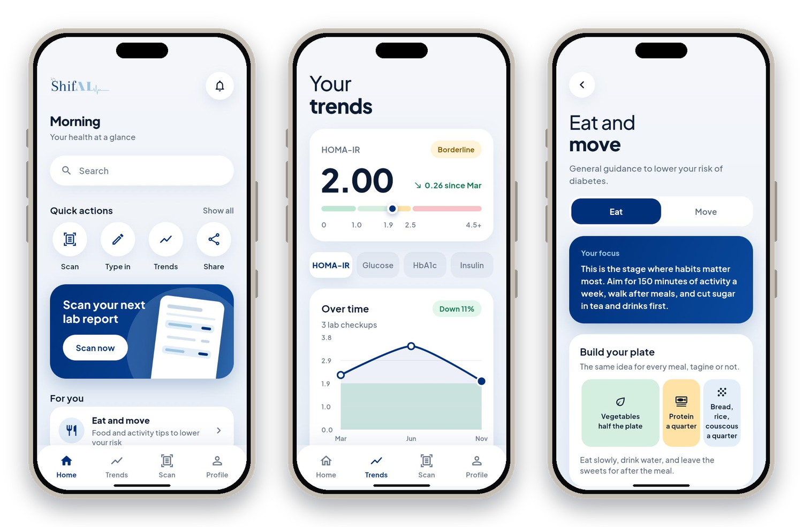
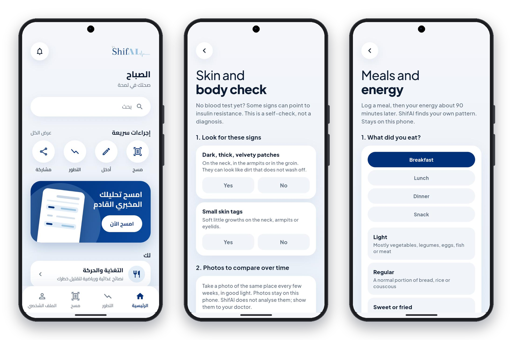

# ShifAI

ShifAI helps users track insulin-resistance and prediabetes risk indicators. It calculates HOMA-IR from confirmed fasting glucose and insulin results. **It is an awareness tool, not a diagnostic device.**

The name comes from the Arabic شفاء (*shifa*, “healing”), with **AI** inside the name.

## Screenshots

Screens use sample data, not a real patient.

<p align="center">
  
</p>

<p align="center"><sub>iPhone 16 Pro: Home, Trends with HOMA-IR over time, and Eat and move.</sub></p>

<p align="center">
  
</p>

<p align="center"><sub>Android: Home in Arabic (the layout flips right to left), Skin and body check, and Meals and energy.</sub></p>

The plain screenshots are in [`docs/screenshots/`](docs/screenshots/).

## What the app includes

**Screen, without a blood test**
- Risk estimate: enter age, sex, height, weight and waist, and an on-device model (a logistic regression plus a small neural network, trained on US NHANES data) estimates the chance that HOMA-IR is 2.5 or higher. See [Risk model](#risk-model).
- Skin and body check: skin signs, a private photo timeline, and the ADA risk questionnaire.

**Measure**
- Lab-report photo capture and gallery selection on Android/iOS, with on-device Google ML Kit text recognition. Extracted values can be reviewed and edited before saving. Manual entry and unit conversion (g/L, mg/dL, mmol/L, µIU/mL, pmol/L) on every platform.
- HOMA-IR with its band, history charts and trends.

**Act**
- Eat and move: a plate guide with Moroccan foods and exercises, and a 150-minute weekly activity goal.
- Meals and energy: log a meal, then your energy later. The app finds your own pattern, on the phone.
- Daily coaching tips.

**Follow up**
- Find a doctor by city (a labelled sample list for now), book an appointment, a daily medicine schedule with a prescription scan, an emergency screen (call 112, warning signs, medical ID), notifications, search, and a WhatsApp summary.

**Everywhere**
- Three languages: English, French and Arabic (right to left, with its own font), and a text size setting.
- Supabase email registration, sign-in, email verification, password reset, and persisted authenticated sessions.
- User-scoped cloud lab records and coaching completion state, protected by Supabase Row-Level Security (RLS).
- AES-GCM encrypted local lab-record cache for offline access. Pending changes are synced when possible, and newer record timestamps win during reconciliation.
- Explicit, repeat-safe import of existing local-only records into a signed-in account. Records are not silently assigned to an account.
- DevicePreview in debug builds, with selectable simulated devices and dimensions.
- Original ShifAI branding and logo at `assets/images/shifai_logo.png`.

## Project structure

Each layer of `lib/` uses the one below it: screens read providers, providers call services, services work on models.

| Folder | What it holds |
| --- | --- |
| `lib/screens/` | One file per screen. They show things and hold no logic. |
| `lib/widgets/`, `lib/theme/` | Shared building blocks, colors and text style. |
| `lib/providers/` | App state (Provider): accounts, lab records, profile, medicine, activity, check-ins, settings. |
| `lib/services/` | The real work: the AI model, the lab and prescription readers, storage, cloud sync, the pattern finder, notifications. |
| `lib/models/` | The data: a lab record (with the HOMA-IR formula), a profile, a meal log, cities, foods. |
| `lib/l10n/` | The French and Arabic translations. |
| `assets/ml/`, `ml/` | The trained model weights, and the Python that trains and validates them. |
| `supabase/migrations/` | The database tables and security rules. |
| `test/` | Automated tests. |

## First-time setup: run in Chrome

This is the easiest way to try ShifAI and does **not** require Android Studio.

### 1. Install the prerequisites

- Install the [Flutter stable SDK](https://docs.flutter.dev/get-started/install). This project requires Dart SDK `^3.13.4`; Flutter 3.47.9 with Dart 3.13.7 was used for development.
- Install [Git](https://git-scm.com/downloads).
- Install [Google Chrome](https://www.google.com/chrome/).

Open a new PowerShell window and check that Flutter is available:

```powershell
flutter --version
flutter doctor -v
```

Resolve Flutter SDK or web setup issues reported by `flutter doctor` before continuing. Android Studio and the Android toolchain are not needed for this Chrome workflow; those warnings can be ignored if you only want the web preview.

### 2. Download the project

On the GitHub page for this repository, select **Code** and copy the HTTPS clone URL. Replace the example URL below with that URL:

```powershell
git clone https://github.com/YOUR-GITHUB-NAME/YOUR-REPOSITORY.git
Set-Location YOUR-REPOSITORY
```

If you already downloaded or cloned the project, open PowerShell in the folder containing this `README.md` instead.

### 3. Get packages and check Chrome is available

```powershell
flutter pub get
flutter devices
```

Confirm that Chrome appears in the device list. If it does not, enable Flutter web support, restart PowerShell, and check again:

```powershell
flutter config --enable-web
flutter devices
```

Continue to the Supabase setup below before trying to sign in or create an account.

### 4. Configure Supabase, then run ShifAI

Create/configure a Supabase project using the next section, then run this command from the project folder. Replace both example values with your own project values:

```powershell
flutter run -d chrome --web-port=5000 --dart-define=SUPABASE_URL=https://YOUR_PROJECT_ID.supabase.co --dart-define=SUPABASE_PUBLISHABLE_KEY=YOUR_PUBLISHABLE_KEY
```

The app opens on the ShifAI sign-in screen. Create an account, verify your email if requested, then sign in. Use **Forgot password?** to request a reset link. An authenticated user is taken to the dashboard.

DevicePreview appears beside the app in debug mode. Use its controls to select an Android model, change orientation, and adjust simulated device settings. It is disabled in release builds.

> **No Supabase configuration yet?** You can still open and inspect the sign-in and account-creation screens. Submitting a form will show a configuration error; the app does not fake sign-in, create an account, or silently switch to a local-only dashboard.

## Supabase setup (one time per Supabase project)

ShifAI requires your own Supabase project for real authentication and cloud sync.

1. Create a project at [Supabase](https://supabase.com/).
2. Set up the database schema:
   - Open the project's **SQL Editor** and create a new query.
   - Open [`supabase/migrations/202606010001_initial_schema.sql`](supabase/migrations/202606010001_initial_schema.sql), copy its contents into the SQL Editor, and run it **once**.
   - This migration creates the profile, lab-report, user-preference, and coaching-completion tables. It enables RLS and adds policies that restrict user data to the authenticated user's `auth.uid()`.
   - To add the optional triglyceride and HDL columns to an existing `lab_reports` table, create another SQL Editor query and run [`supabase/migrations/202611220001_add_triglycerides_hdl.sql`](supabase/migrations/202611220001_add_triglycerides_hdl.sql). It is safe to run repeatedly and does not change existing rows or RLS policies. Afterward, confirm `triglycerides_mg_dl` and `hdl_mg_dl` appear under **Table Editor → lab_reports**.
3. Configure authentication:
   - In **Authentication → Providers**, enable email/password sign-up.
   - For local testing only, in **Authentication → Providers → Email**, turn **Confirm email** off so test accounts can sign in without email verification. Turn it back on before production. When confirmation is enabled, users must follow the verification link before signing in.
   - In **Authentication → URL Configuration → Redirect URLs**, add `http://localhost:5000` as the local test URL for the Chrome command in this guide. Also add your production HTTPS origin when deploying, and `com.shifai.shifai://login-callback/` for native Android/iOS authentication. If you run Chrome on another port, allow that exact origin instead.
4. Get the two client values:
   - In **Project Settings → API** (or **API Keys**), copy the **Project URL** and the **publishable key**. A legacy `anon` key can also be used.
   - Use the Project URL as `SUPABASE_URL` and the publishable/anon key as `SUPABASE_PUBLISHABLE_KEY` in the run command above.
   - Replace `YOUR_PROJECT_ID` and `YOUR_PUBLISHABLE_KEY`; do not include angle brackets or quotes.

The two `--dart-define` values are read at build time. Restart the app whenever you change them. For a web release build, use:

```powershell
flutter build web --release --dart-define=SUPABASE_URL=https://YOUR_PROJECT_ID.supabase.co --dart-define=SUPABASE_PUBLISHABLE_KEY=YOUR_PUBLISHABLE_KEY
```

The publishable/anon key is intended for client apps. **Never use or publish a Supabase `service_role` or secret key in Flutter, GitHub, or build commands.** RLS must remain enabled; a client key does not replace database access policies.

For browser-based password reset and email verification, Supabase must allow the app's current web origin. The Chrome command above uses `http://localhost:5000`. For production, configure the corresponding HTTPS origin in Supabase and deploy the web build over HTTPS.

## Risk model

`ml/train_models.py` downloads public NHANES 2013-2018 files from the CDC, keeps adults with fasting glucose and insulin (excluding pregnancy and diagnosed diabetes), and trains models that predict HOMA-IR >= 2.5. Each input set is a logistic regression plus a small neural network (two hidden layers) whose probabilities are averaged. The weights are exported to `assets/ml/risk_model.json` and evaluated in Dart (`lib/services/risk_model.dart`); a test checks that the Dart output matches scikit-learn to six decimals.

| Input set | Used when | Cross-validated AUC (average of both models) |
| --- | --- | --- |
| `basic`: age, sex, BMI, waist-to-height | no blood test | 0.802 |
| `lab`: basic + fasting glucose, HbA1c, triglycerides, HDL | blood values but no insulin value | 0.869 |

Asking about family history and weekly activity did not improve either set on the same people, so they are not model inputs. Full numbers: `ml/model_results.json`.

**The cut-off.** There is no universal HOMA-IR threshold: published cut-offs differ by population (a 2025 meta-analysis of 87 studies, and a Qatar Biobank study that derived a lower cut-off for a Middle Eastern population). The app uses **2.5** for "insulin resistance likely": it is close to the local laboratory's own flags (upper normal 2.25, "important" above 2.4), it favours sensitivity as a screening tool should, and the models' accuracy barely changes with the cut-off (tested at 2.5 and 2.9). Bands: below 1.0 optimal, below 1.9 normal, below 2.5 borderline, 2.5 and above likely. This is a screening threshold, not a diagnosis.

**Newer-data check.** `ml/validate_2021_2023.py` trains on 2013-2018 and tests on the 2021-2023 round (never seen in training). At a 2.5 cut-off: `basic` 0.816 AUC, `lab` 0.884 AUC, with predicted risk within about one point of the real share. XGBoost with 12 inputs (see the `shifai_model` branch) scored 0.815 on the same round: no gain over the 4-input model. Results: `ml/validation_2021_2023.json`.

```powershell
pip install -r ml/requirements.txt
python ml/train_models.py
```

`ml/compare_models.py` is an earlier exploration that also compares gradient boosting.

Honest limits: the data is from a US population and may be less accurate elsewhere, the label (HOMA-IR >= 2.5) is a proxy and not a diagnosis, glucose is part of the HOMA-IR formula (so the `lab` set partly rebuilds it, and the model is still useful because it needs no insulin value), and there is no external validation yet.

### Skin photo model (experiment, not in the app)

`ml/skin_model/` holds a first experiment on a photo model for acanthosis nigricans, a skin sign that can go with insulin resistance (MobileNetV3 Small, pretrained, trained on Fitzpatrick17k and then on Fitzpatrick17k plus Google SCIN). It has only 22 to 24 positive images and 7 to 8 test images, so its test results are not reliable, there are no test images on darker skin, and it is **not used in the app**. Notebooks, results, limits and dataset licences: [`ml/skin_model/README.md`](ml/skin_model/README.md).

### Database

Triglycerides and HDL are stored in `lab_reports`. Run `supabase/migrations/202611220001_add_triglycerides_hdl.sql` once in the Supabase SQL Editor. The app only sends these two columns when a value is entered, so it keeps working against a database that does not have them yet.

## Run automated checks

From the project folder:

```powershell
flutter analyze
flutter test
flutter build web --debug
```

## Data, privacy, and platform limitations

- Lab records are cached locally using AES-GCM encryption; encryption keys and Supabase auth session values use platform secure storage. Browser secure storage requires a secure context; localhost and HTTPS provide one.
- Offline changes sync when connectivity returns. Existing local-only records can be imported from the signed-in profile screen after reviewing the import prompt.
- Chrome does not support this project's native Google ML Kit OCR or native camera/gallery scan workflow. The web scan entry provides manual lab entry instead; it does not claim to scan an image.
- Android/iOS scanning uses the device camera or image gallery and processes OCR on-device. Report images are not uploaded. PDF OCR and a flashlight/torch control are not implemented.
- Account deletion is not provided in the client; a production deletion flow should use a suitably authorized server-side function.
- The sign-up privacy and health-use notices are starter disclosures and should be reviewed for your jurisdiction before public release.
- ShifAI does not claim end-to-end encryption and does not diagnose a medical condition. Review results and treatment decisions with a healthcare professional.

## Disclaimer

ShifAI is an early-awareness tool, not a diagnostic device or a substitute for professional medical care. Always confirm results and treatment decisions with a healthcare professional.
